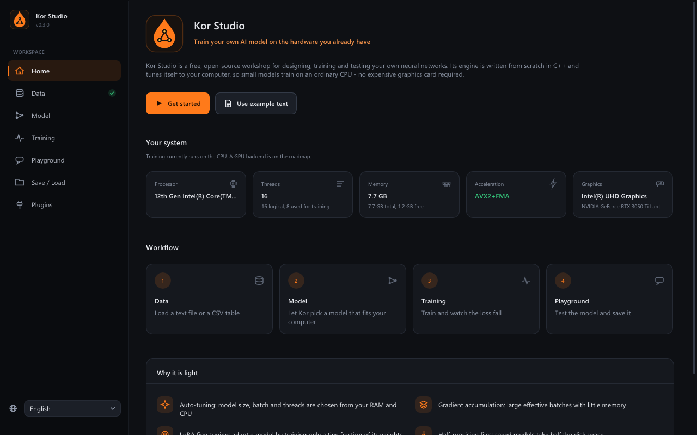
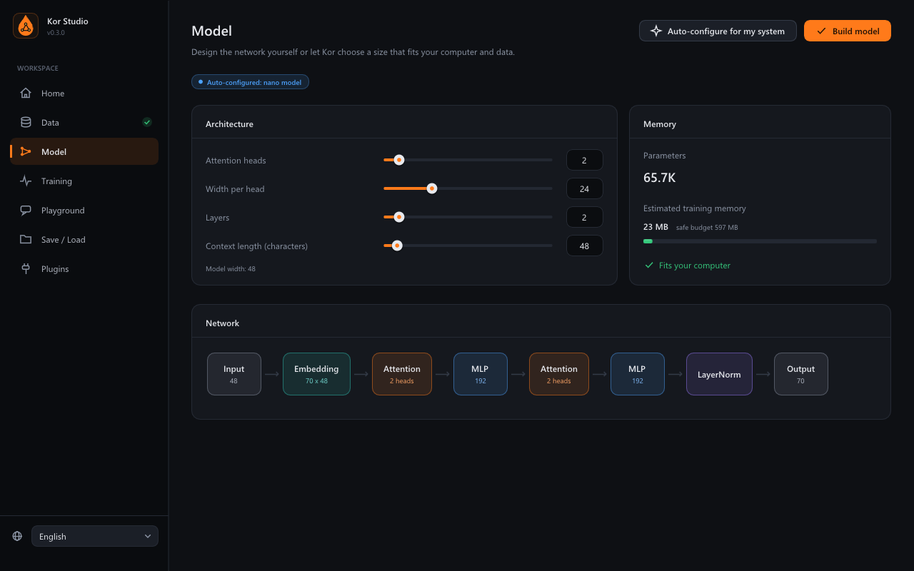
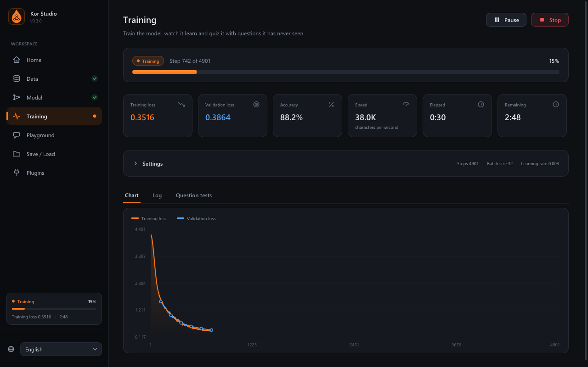
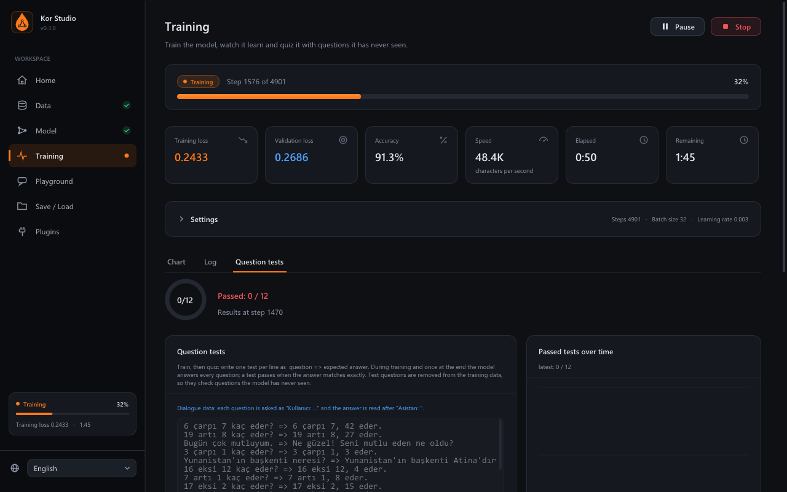
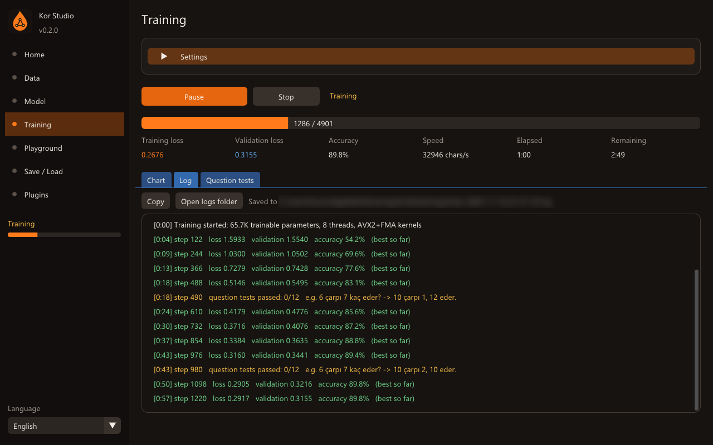
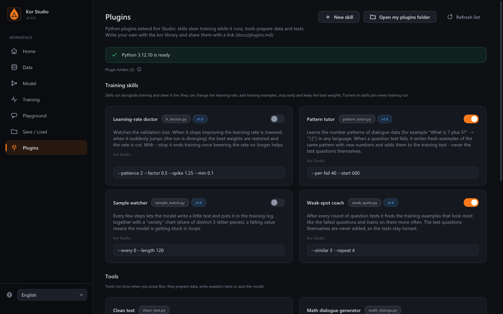
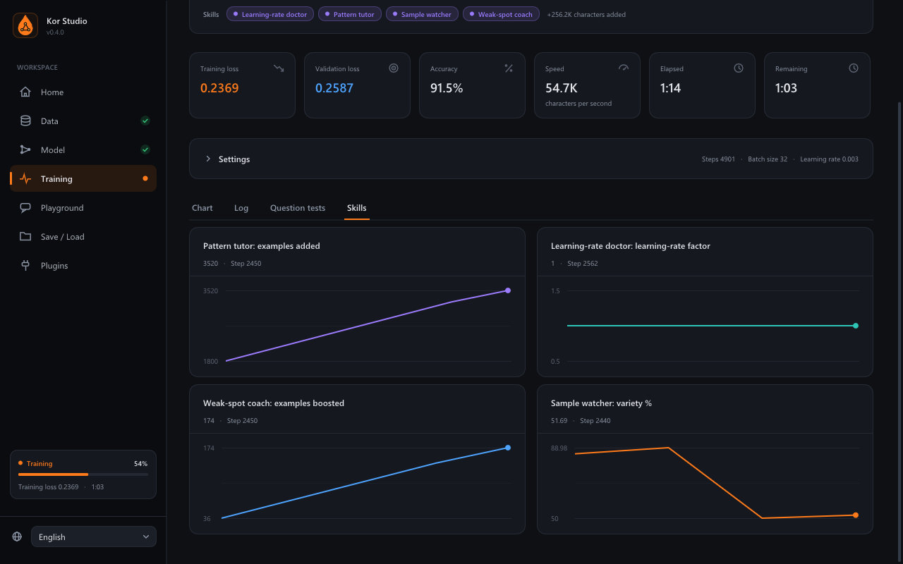
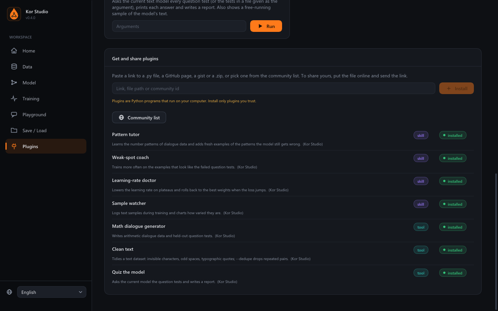

<p align="center"></p>

<h1 align="center">Kor Studio</h1>

<p align="center">
  <b>Design, train and test your own neural networks on the hardware you already have.</b><br>
  A desktop AI workshop with a training engine written from scratch in C++17. No Python stack, no GPU required.
</p>

<p align="center">
  <a href="https://github.com/Hydra-Ai-tr/kor-studio/releases/latest"></a>
  <a href="LICENSE"></a>
  
  
  
</p>

<p align="center">
  English · <a href="docs/README.tr.md">Türkçe</a> · <a href="docs/README.ru.md">Русский</a>
</p>

<p align="center"></p>

---

## Overview

Kor Studio is a free, open-source desktop application for building small neural networks end to
end: load a dataset, let the app size a model for your machine, watch it train, quiz it, and save
it. Everything runs locally on an ordinary CPU.

The engine (`korcore`) is a self-contained C++17 library with its own tensors, layers, automatic
gradients, optimizers and a GPT-style transformer. It does not depend on PyTorch, TensorFlow or
any other ML framework, which keeps the whole program a single small executable and makes the
code a readable reference for how training actually works.

> *Kor* is Turkish for *ember*: a small glow that is enough to start a fire.

## Highlights

- **Two kinds of models.** Plain text trains a character-level transformer language model; a CSV
  table trains a classifier or a regressor. The task is detected from the data.
- **Auto-configuration.** Model size, batch size and thread count are picked from your free RAM,
  CPU cores and dataset size, with an estimate of the memory needed before you build.
- **Live training dashboard.** Loss and validation curves, accuracy, throughput, ETA,
  pause / resume / stop, early stopping, and keeping the best weights.
- **Train-then-ask question tests on unseen questions.** Write `question => expected answer`
  pairs (generated automatically for dialogue data). Test questions are removed from the
  training data, so they measure generalization, not memorization. The model is quizzed during
  training, keeps the checkpoint that answered the most questions, and can stop as soon as every
  answer is correct.
- **Training log.** Every event is shown in the app and saved to a timestamped log file.
- **Training skills in Python.** Skills run next to the trainer and steer it live: they change
  the learning rate, add training examples where the model is weak, restore the best weights,
  stop early and chart their own metrics. Write one in a few lines with the `kor` library.
- **Share plugins with a link.** Install skills and tools from a GitHub page, a gist, a `.zip`
  or the community list, in the app or with `python -m kor install`.
- **Playground.** Generate text or run predictions, even while training continues.
- **Open model format.** Models are saved as [`.kor` files](docs/kor-format.md), optionally in
  half precision.
- **Command-line tool.** `kor-cli` trains, tests and samples models for scripting and CI.
- **Modern desktop interface.** A sidebar workspace with cards, live status and a dark theme,
  rendered with Dear ImGui and scaled for high-DPI screens.
- **Three interface languages.** English, Turkish and Russian, switchable at runtime.

## Screenshots

<table>
  <tr>
    <td width="50%"><br><sub><b>Home</b>: hardware detection and quick start</sub></td>
    <td width="50%"><br><sub><b>Model</b>: visual architecture and memory estimate</sub></td>
  </tr>
  <tr>
    <td><br><sub><b>Training</b>: live loss and validation curves</sub></td>
    <td><br><sub><b>Question tests</b>: held-out questions the model never saw</sub></td>
  </tr>
  <tr>
    <td><br><sub><b>Training log</b>: shown live and saved to a file</sub></td>
    <td><br><sub><b>Plugins</b>: training skills and tools</sub></td>
  </tr>
  <tr>
    <td><br><sub><b>Skills</b>: what each skill did, charted live</sub></td>
    <td><br><sub><b>Sharing</b>: install from a link or the community list</sub></td>
  </tr>
</table>

## Download

**Windows:** download `kor-studio-<version>-windows-x64.zip` from the
[latest release](https://github.com/Hydra-Ai-tr/kor-studio/releases/latest), extract it, and run
`kor-studio.exe`. It needs no installer or runtime; Windows 10 or newer is required. Python 3 is
only needed for plugins.

**Linux and macOS:** build from source (see [Building from source](#building-from-source)).

## Quick start

1. **Data:** choose *Use example text* (or load your own `.txt` / `.csv`).
2. **Model:** press *Auto-configure for my system*, then *Build model*.
3. **Training:** press *Start training*. Watch the curves, the log and the question tests.
4. **Playground:** type a prompt and generate text from the model.
5. **Save / Load:** store the model as a `.kor` file.

The bundled `examples/diyalog_tr.txt` is a short Turkish question-and-answer dialogue. On a
laptop CPU (Intel i5-12500H), the auto-configured 66K-parameter model trains on it in about three
minutes.

## Question tests

Loss tells you the model is learning; question tests tell you *what* it learned. A test file has
one question per line:

```text
# lines starting with # are comments
What is the capital of Italy? => The capital of Italy is Rome.
7 times 6 => 42
```

For dialogue data (pairs of lines such as `User:` / `Assistant:`), Kor Studio detects the speaker
tags, builds the prompt `User: <question>\nAssistant:` and compares the model's greedy answer with
the expected one. Tests run every few hundred steps during training; the trainer keeps the weights
that passed the most tests (or the lowest validation loss while none pass) and can stop when the
target pass rate is reached.

**Tests are always held out.** Before training starts, every line that asks a test question (and
the answer that follows it) is removed from the training and validation text, and the log reports
how many lines were removed. A passing test therefore means the model answered a question it has
never seen. On the bundled dialogue example, the 66K-parameter model reaches 92% next-character
accuracy but passes 0 of 12 held-out questions. It has learned the style of the conversation, not
arithmetic or facts it was never shown, and the test makes that visible.

## Skills and plugins

Plugins are Python 3 scripts built on the bundled `kor` library. **Skills** run during training
and can change it; **tools** run once to prepare data or tests. A complete skill:

```python
# kor-plugin
# type: skill
# name: Plateau breaker
# description: Halves the learning rate when the validation loss stops improving.

import kor

skill = kor.Skill()

@skill.on_eval
def check(run, ev):
    if not ev.improved:
        run.scale_lr(0.5)
        run.log(f"no progress, learning rate x{run.lr_factor:.2f}", "warn")

if __name__ == "__main__":
    skill.run()
```

Handlers receive the run and the event. Besides the learning rate, a skill can add training text
(`run.add_pairs`), ask the live model questions (`run.ask`), generate samples, save or restore
the best weights, stop training and record metrics that the Training page charts. Turn skills on
in the Plugins page, or pass them to the command line:

```bash
kor-cli train examples/diyalog_tr.txt --skill plugins/pattern_tutor.py --skill plugins/weak_spots.py
```

Skills make a measurable difference. On the bundled dialogue example (same model, same seed), the
default run answers 0 of 12 held-out questions; with `pattern_tutor` and `weak_spots` it answers
3 of 12, and the validation loss falls from 0.299 to 0.233.

| Bundled plugin | Kind | What it does |
|---|---|---|
| `pattern_tutor.py` | skill | Learns the number patterns of dialogue data in any language and adds fresh examples of the ones the model fails |
| `weak_spots.py` | skill | Trains more often on examples similar to the failed questions |
| `lr_doctor.py` | skill | Lowers the learning rate on plateaus, rolls back when the loss jumps |
| `sample_watch.py` | skill | Logs samples during training and charts their variety |
| `clean_text.py` | tool | Normalizes whitespace and quotes and removes duplicate Q/A pairs |
| `math_dialogs.py` | tool | Generates arithmetic dialogues plus held-out test questions |
| `quiz.py` | tool | Asks the model every test question and writes a report |

**Sharing.** A plugin is one `.py` file. Put it on GitHub or in a gist and share the link; others
install it from the Plugins page or with `python -m kor install <link>`. `python -m kor new`
writes a template, `python -m kor check` validates a plugin, and a pull request to
[`community/index.json`](community/index.json) adds it to the community list shown in the app.
The full guide, API and protocol are in [docs/plugins.md](docs/plugins.md).

## Command line

```bash
kor-cli sysinfo                                  # detected hardware and chosen kernels
kor-cli selftest                                 # gradient checks for every layer
kor-cli train examples/spiral.csv                # auto-configured table training
kor-cli train notes.txt --steps 2000 --out notes.kor
kor-cli train examples/diyalog_tr.txt --target 1 --log train.log --out chat.kor
kor-cli test chat.kor tests.txt --data examples/diyalog_tr.txt
kor-cli generate chat.kor "Kullanıcı: Merhaba" --len 200
```

Training options: `--steps N`, `--patience N` (early stopping), `--tests file`,
`--target 0..1` (stop at this pass rate), `--log file`, `--out file`, `--text` / `--table`,
`--skill "file.py [args]"` (repeatable), `--python <command>`, `--lang en|tr|ru`.

## Building from source

Requirements: CMake 3.20+, a C++17 compiler (GCC, Clang or MSVC), Git and OpenGL 3.0.
GLFW and Dear ImGui are fetched automatically by CMake.

```bash
git clone https://github.com/Hydra-Ai-tr/kor-studio.git
cd kor-studio
cmake -S . -B build -G Ninja -DCMAKE_BUILD_TYPE=Release
cmake --build build
./build/bin/kor-studio
```

- **Linux:** install the GLFW build dependencies first, e.g. `sudo apt install xorg-dev libgl1-mesa-dev`.
- **Engine and CLI only:** add `-DKOR_BUILD_GUI=OFF`.
- **Verify the engine:** `./build/bin/kor-cli selftest` compares every analytic gradient with
  finite differences.

## Under the hood

| Technique | Benefit |
|---|---|
| Hardware auto-tuning | Model, batch and thread settings sized to free RAM, cores and data |
| Gradient accumulation | Large effective batches with only one small batch in memory |
| LoRA fine-tuning | Adapt a trained model by training a small fraction of its weights |
| AdamW with warm-up and cosine decay | Stable training without hand-tuning |
| Runtime SIMD dispatch | AVX2/FMA kernels when available, portable code otherwise |
| Half-precision checkpoints | Saved models take half the disk space |
| Zero-dependency engine | The trainer is one small static library |

## Scope and limitations

Kor Studio trains on the **CPU** and is designed for small models: tabular networks and
character-level transformers up to a few million parameters, which train in seconds to minutes on
a laptop. It is a tool for learning, experimentation and small, focused models. It will not
train a large language model. A GPU backend is on the roadmap.

## Project layout

```text
src/core/    training engine: tensors, layers, transformer, optimizers, trainer, auto-tuner
src/app/     desktop application (Dear ImGui + GLFW), plugin runner, translations (i18n.h)
src/skills/  bridge between the trainer and Python skills (processes, JSON line protocol)
src/cli/     kor-cli command-line tool
python/kor/  the kor Python library: skills, tool helpers, plugin installer
plugins/     bundled skills and tools
community/   the community plugin list
examples/    small demo datasets
docs/        file format, plugin guide, translated READMEs, screenshots
assets/      logo and application icon
```

## Roadmap

- GPU backend (Vulkan compute) and int8 quantized export
- Sub-word (BPE) tokenizer and larger text models
- Image datasets and convolutional layers
- More dataset tools: splitting, augmentation, format conversion
- More interface languages: add a column to `src/app/i18n.h`

## Contributing

Bug reports, ideas and pull requests are welcome; please open an
[issue](https://github.com/Hydra-Ai-tr/kor-studio/issues) to discuss larger changes first. Before
submitting a change to the engine, run `kor-cli selftest` and make sure it passes. New plugins and
translations are especially appreciated.

## License

Kor Studio is released under the [MIT License](LICENSE). It uses
[Dear ImGui](https://github.com/ocornut/imgui) (MIT) and [GLFW](https://www.glfw.org) (zlib).
