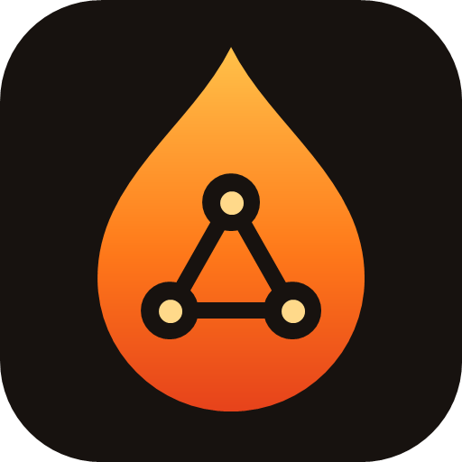
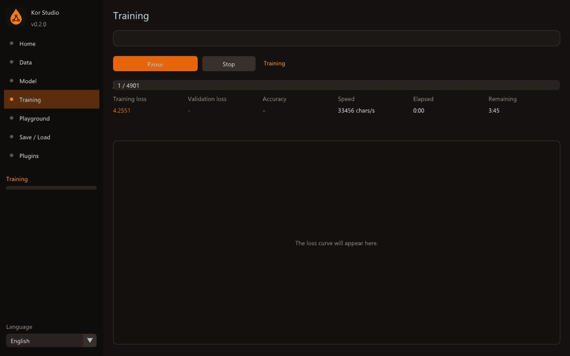
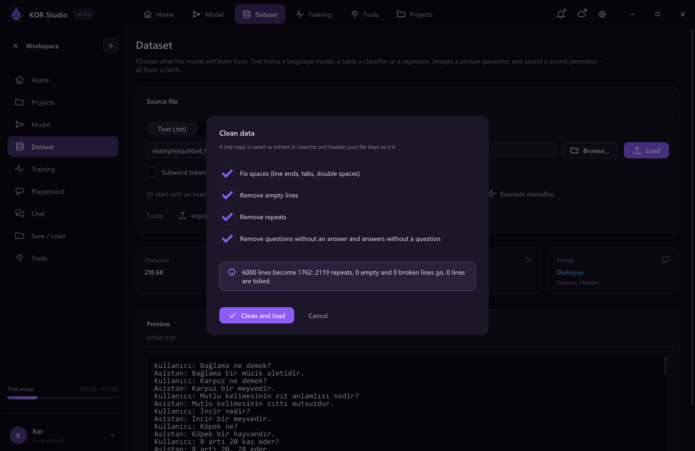

<p align="center"></p>

<h1 align="center">Kor Studio</h1>

<p align="center">
  <b>Design, train and test your own neural networks on the hardware you already have.</b><br>
  A desktop AI workshop with a training engine written from scratch in C++17. No Python stack, no GPU required.
</p>

<p align="center">
  <a href="https://github.com/Hydra-Ai-tr/kor-studio/releases/latest"></a>
  <a href="LICENSE"></a>
  <a href="https://github.com/Hydra-Ai-tr/kor-studio/actions/workflows/build.yml"></a>
  
  
  
</p>

<p align="center">
  English · <a href="docs/README.tr.md">Türkçe</a> · <a href="docs/README.ru.md">Русский</a>
</p>

<p align="center"></p>

---

## Overview

Kor Studio is a free, open-source desktop application for building small neural networks end to
end: load a dataset, let the app size a model for your machine, watch it train, quiz it, and save
it. Everything runs locally on an ordinary CPU; a graphics card can speed up text models, but is
never required.

The engine (`korcore`) is a self-contained C++17 library with its own tensors, layers, automatic
gradients, optimizers and a GPT-style transformer. It does not depend on PyTorch, TensorFlow or
any other ML framework, which keeps the whole program a single small executable and makes the
code a readable reference for how training actually works.

> *Kor* is Turkish for *ember*: a small glow that is enough to start a fire.

## Highlights

- **Text, tables, images and sound, all from scratch.** Plain text trains a transformer language
  model (one token per character, or learned subword tokens for larger texts); a CSV table trains a
  classifier or a regressor; a folder of pictures trains an image generator; WAV files train a
  sound generator. The kind is detected from the data.
- **Fine-tuning.** Load a saved `.kor` model and keep training it on new data, fully or with LoRA.
  Characters the model does not know yet are added to it; pictures and sound are read in the
  format of the loaded model.
- **Strong training defaults.** For dialogue data the auto-planner picks a model and context large
  enough for whole question-answer pairs, starts most training rows at a question and weights the
  loss toward the answers. Dropout and weight averaging (EMA) are one switch away.
- **Auto-configuration.** Model size, batch size and thread count are picked from your free RAM,
  CPU cores and dataset size, with an estimate of the memory needed before you build.
- **Live training dashboard.** Loss and validation curves, accuracy, throughput, ETA,
  pause / resume / stop, early stopping, and keeping the best weights.
- **Train-then-ask question tests on unseen questions.** Write `question => expected answer`
  pairs (generated automatically for dialogue data). Test questions are removed from the
  training data, so they measure generalization, not memorization. The model is quizzed during
  training, keeps the checkpoint that answered the most questions, and can stop as soon as every
  answer is correct.
- **Training log.** Every event is shown in the app and saved to a timestamped log file.
- **Crash-safe training.** A run saves itself every minute, when paused and when stopped
  (weights, optimizer state, best weights, curves). After a power cut or a closed app the next
  start offers *Continue training*, which picks up at the exact step. Saves go to a temporary
  file first and the previous one is kept as a backup, so a half-written file never breaks a run.
- **Compare trainings.** Every finished or stopped run is recorded. The *Compare* tab draws the
  validation (or training) loss curves of several runs on one chart, next to a table of their
  data, model, steps, time, best loss, accuracy and test results.
- **Dataset tools.** Import chat datasets in JSON Lines (OpenAI `messages`, ShareGPT, Alpaca,
  `prompt`/`completion`) as question-answer text, and clean a text before training: tidy spaces,
  drop empty lines, repeated question-answer pairs and questions without an answer. The tool
  shows what will change before it writes a cleaned copy; your file stays as it is.
- **Graphics card (experimental).** Text models can run their large matrix products on an
  OpenCL GPU. The results are checked against the CPU and both are timed at the start; when the
  card is missing, wrong or slower, training simply stays on the CPU.
- **Chat page.** Finished models are saved automatically; pick any `.kor` model and talk to it,
  with temperature, answer length and conversation memory settings.
- **Local OpenAI-compatible API.** `kor-cli serve` (or *Serve as API* on the chat page) offers a
  model at `http://127.0.0.1:8080/v1`, so tools written for the OpenAI API can use it.
- **Update notice.** The app tells you when a new release is out (can be turned off in the
  settings).
- **Projects.** A project folder keeps the dataset, its model, the training settings and the
  question tests together; it saves itself when a training finishes and when the app closes.
  The home page shows recent projects, recent activity, model and dataset counts and the live
  CPU, memory and GPU memory load. `Ctrl+K` searches pages and actions, `Ctrl+S` saves the
  project, `Ctrl+O` opens one, `Ctrl+,` opens the settings and ``Ctrl+` `` opens a terminal with
  `kor-cli` ready in the project folder.
- **Training skills in Python.** Skills run next to the trainer and steer it live: they change
  the learning rate, add training examples where the model is weak, restore the best weights,
  stop early and chart their own metrics. Write one in a few lines with the `kor` library.
- **Share plugins with a link.** Install skills and tools from a GitHub page, a gist, a `.zip`
  or the community list, in the app or with `python -m kor install`.
- **Playground.** Generate text, pictures or sound, or run predictions, even while training
  continues. Pictures are saved as PNG, sound as WAV and can be played in the app.
- **Open model format.** Models are saved as [`.kor` files](docs/kor-format.md), optionally in
  half precision.
- **Command-line tool.** `kor-cli` trains, tests and samples models for scripting and CI.
- **Modern desktop interface.** A sidebar workspace with cards, live status and a dark purple theme,
  rendered with Dear ImGui and scaled for high-DPI screens.
- **Three interface languages.** English, Turkish and Russian, switchable at runtime.

## Screenshots

<table>
  <tr>
    <td width="50%"><br><sub><b>Home</b>: hardware detection and quick start</sub></td>
    <td width="50%"><br><sub><b>Model</b>: visual architecture and memory estimate</sub></td>
  </tr>
  <tr>
    <td><br><sub><b>Training</b>: live loss and validation curves</sub></td>
    <td><br><sub><b>Question tests</b>: held-out questions the model never saw</sub></td>
  </tr>
  <tr>
    <td><br><sub><b>Training log</b>: shown live and saved to a file</sub></td>
    <td><br><sub><b>Plugins</b>: training skills and tools</sub></td>
  </tr>
  <tr>
    <td><br><sub><b>Skills</b>: what each skill did, charted live</sub></td>
    <td><br><sub><b>Sharing</b>: install from a link or the community list</sub></td>
  </tr>
  <tr>
    <td><br><sub><b>Dataset tools</b>: see what cleaning changes before a copy is written</sub></td>
    <td></td>
  </tr>
</table>

## Download

**Windows:** from the [latest release](https://github.com/Hydra-Ai-tr/kor-studio/releases/latest)
download either `kor-studio-<version>-setup.exe` (installs for your user, with a Start menu entry
and an optional `kor-cli` on the PATH) or the portable `kor-studio-<version>-windows-x64.zip`
(extract and run `kor-studio.exe`). Windows 10 or newer is required. Python 3 is only needed for
plugins. The programs are not code-signed yet, so Windows SmartScreen may ask for confirmation
(*More info* → *Run anyway*).

**Linux:** releases published by the CI include `kor-studio-<version>-linux-x86_64.tar.gz`
(built on Ubuntu 22.04). **macOS:** build from source (see
[Building from source](#building-from-source)).

## Quick start

1. **Data:** choose *Use example text* (or load your own `.txt` / `.csv`, a folder of pictures or
   WAV files; *Example pictures* and *Example melodies* create demo data).
2. **Model:** press *Auto-configure for my system*, then *Build model*.
3. **Training:** press *Start training*. Watch the curves, the log and the question tests.
4. **Playground:** type a prompt and generate text from the model.
5. **Save / Load:** store the model as a `.kor` file.

The bundled `examples/diyalog_tr.txt` is a short Turkish question-and-answer dialogue. On a
laptop CPU (Intel i5-12500H), the auto-configured 66K-parameter model trains on it in about three
minutes.

## Question tests

Loss tells you the model is learning; question tests tell you *what* it learned. A test file has
one question per line:

```text
# lines starting with # are comments
What is the capital of Italy? => The capital of Italy is Rome.
7 times 6 => 42
```

For dialogue data (pairs of lines such as `User:` / `Assistant:`), Kor Studio detects the speaker
tags, builds the prompt `User: <question>\nAssistant:` and compares the model's greedy answer with
the expected one. Tests run every few hundred steps during training; the trainer keeps the weights
that passed the most tests (or the lowest validation loss while none pass) and can stop when the
target pass rate is reached.

**Tests are always held out.** Before training starts, every line that asks a test question (and
the answer that follows it) is removed from the training and validation text, and the log reports
how many lines were removed. A passing test therefore means the model answered a question it has
never seen. On the bundled dialogue example, the 66K-parameter model reaches 92% next-character
accuracy but passes 0 of 12 held-out questions. It has learned the style of the conversation, not
arithmetic or facts it was never shown, and the test makes that visible.

## Skills and plugins

Plugins are Python 3 scripts built on the bundled `kor` library. **Skills** run during training
and can change it; **tools** run once to prepare data or tests. A complete skill:

```python
# kor-plugin
# type: skill
# name: Plateau breaker
# description: Halves the learning rate when the validation loss stops improving.

import kor

skill = kor.Skill()

@skill.on_eval
def check(run, ev):
    if not ev.improved:
        run.scale_lr(0.5)
        run.log(f"no progress, learning rate x{run.lr_factor:.2f}", "warn")

if __name__ == "__main__":
    skill.run()
```

Handlers receive the run and the event. Besides the learning rate, a skill can add training text
(`run.add_pairs`), ask the live model questions (`run.ask`), generate samples, save or restore
the best weights, stop training and record metrics that the Training page charts. Turn skills on
in the Plugins page, or pass them to the command line:

```bash
kor-cli train examples/diyalog_tr.txt --skill plugins/pattern_tutor.py --skill plugins/weak_spots.py
```

Skills make a measurable difference. On the bundled dialogue example (same model, same seed), the
default run answers 0 of 12 held-out questions; with `pattern_tutor` and `weak_spots` it answers
3 of 12, and the validation loss falls from 0.299 to 0.233.

| Bundled plugin | Kind | What it does |
|---|---|---|
| `pattern_tutor.py` | skill | Learns the number patterns of dialogue data in any language and adds fresh examples of the ones the model fails |
| `weak_spots.py` | skill | Trains more often on examples similar to the failed questions |
| `lr_doctor.py` | skill | Lowers the learning rate on plateaus, rolls back when the loss jumps |
| `sample_watch.py` | skill | Logs samples during training and charts their variety |
| `clean_text.py` | tool | Normalizes whitespace and quotes and removes duplicate Q/A pairs |
| `math_dialogs.py` | tool | Generates arithmetic dialogues plus held-out test questions |
| `quiz.py` | tool | Asks the model every test question and writes a report |

**Sharing.** A plugin is one `.py` file. Put it on GitHub or in a gist and share the link; others
install it from the Plugins page or with `python -m kor install <link>`. `python -m kor new`
writes a template, `python -m kor check` validates a plugin, and a pull request to
[`community/index.json`](community/index.json) adds it to the community list shown in the app.
The full guide, API and protocol are in [docs/plugins.md](docs/plugins.md).

## Command line

```bash
kor-cli sysinfo                                  # detected hardware and chosen kernels
kor-cli selftest                                 # gradient checks for every layer
kor-cli train examples/spiral.csv                # auto-configured table training
kor-cli train notes.txt --steps 2000 --out notes.kor
kor-cli train examples/diyalog_tr.txt --target 1 --log train.log --out chat.kor
kor-cli test chat.kor tests.txt --data examples/diyalog_tr.txt
kor-cli generate chat.kor "Kullanıcı: Merhaba" --len 200
kor-cli train big.txt --subword 2000 --out llm.kor          # subword language model
kor-cli train chat.txt --from llm.kor --lora 8 --out chat.kor  # fine-tune a saved model
kor-cli train big.txt --out llm.kor --resume                # continue a cut-off run (Ctrl+C saves and stops)
kor-cli demo-images pictures && kor-cli train pictures --out img.kor
kor-cli generate img.kor --count 16 --out new.png           # a sheet of new pictures
kor-cli demo-sounds melodies && kor-cli train melodies --out snd.kor
kor-cli generate snd.kor --seconds 3 --out new.wav
kor-cli data import chats.jsonl --out chats.txt            # JSON Lines chat data to dialogue text
kor-cli data clean chats.txt                               # tidied copy: chats-clean.txt
kor-cli serve chat.kor --port 8080                         # OpenAI-compatible API
kor-cli gpu                                                # check the graphics card against the CPU
kor-cli train big.txt --gpu --out llm.kor                  # large products on the GPU (experimental)
```

Training options: `--steps N`, `--patience N` (early stopping), `--tests file`,
`--target 0..1` (stop at this pass rate), `--log file`, `--out file`,
`--text` / `--table` / `--images` / `--audio`, `--subword N`, `--size N` / `--colors N` /
`--no-mirror` (images), `--rate N` (sound), `--from model.kor [--lora R]` (fine-tuning),
`--dim/--layers/--heads/--ctx` (model size), `--lr`, `--batch`, `--threads`, `--gpu`, `--seed`, `--wd`,
`--align 0..1`, `--prompt-weight 0..1`, `--dropout X`, `--ema 0.999`,
`--resume` / `--fresh` / `--checkpoint file` / `--checkpoint-every 60` / `--no-checkpoint`
(autosave, by default to `<out>.autosave`),
`--skill "file.py [args]"` (repeatable), `--python <command>`, `--lang en|tr|ru`.

### Local API

`kor-cli serve model.kor` answers on `http://127.0.0.1:8080/v1` with the OpenAI endpoints
`/v1/models`, `/v1/chat/completions` and `/v1/completions`, including streaming. Chat messages
are turned into the model's dialogue format (`Kullanıcı: ` / `Asistan: ` by default, or the
tags stored in the model). By default only this computer can reach it; `--host 0.0.0.0` opens it
to the network, where `--api-key KEY` should be used as well.

```bash
curl http://127.0.0.1:8080/v1/chat/completions -H "Content-Type: application/json" \
  -d '{"messages":[{"role":"user","content":"Merhaba, nasılsın?"}],"max_tokens":80}'
```

### Dataset tools

`kor-cli data import` reads JSON Lines (or one JSON array) and writes dialogue text: OpenAI
`messages` (system messages are skipped), ShareGPT `conversations`, Alpaca
`instruction`/`input`/`output`, `prompt`/`completion` and `question`/`answer` records become
question and answer lines, and records with only `text` become paragraphs. Line breaks inside a
message become spaces, and a dialogue that ends with a question loses that question. In the
app, loading a `.jsonl` file imports it the same way.

`kor-cli data clean` writes a tidied copy (`--keep-duplicates` and `--keep-empty` turn parts
off). In dialogue data it removes repeated question-answer pairs and lines that lost their
partner; in plain text it removes repeated lines of 24 characters or more.

### Graphics card (experimental)

With `--gpu` (or *Graphics card* in the training settings) the large matrix products of the
transformer run through OpenCL, which comes with the drivers of most graphics cards; nothing
extra is installed. At the start the GPU results are compared with the CPU and both are timed;
only products large enough to gain go to the GPU, and any GPU error switches back to the CPU.
Attention, the optimizer and everything else stay on the CPU, so the gain depends on the model:
large models gain the most, tiny ones none. `kor-cli gpu` prints the comparison. On an RTX 3050
Ti Laptop GPU, training-sized products (2048 x 256 x 768) ran 5 to 9 times faster than on the
CPU, copies included.

### How images and sound are learned

Images and sound go through the same transformer as text, as sequences of tokens. A picture is
cropped to a square, scaled to 16 x 16 (8 to 64 with `--size`), and each pixel becomes one of 32
palette colours found by k-means (`--colors`); the model then draws pictures pixel by pixel, like
ImageGPT. Sound is resampled to 8 kHz (`--rate`) and every sample becomes one of 256 mu-law
levels, as in WaveNet. Both are small, CPU-friendly versions of these ideas: expect simple shapes
and short melodies rather than photographs or speech. Generation uses a key/value cache, so each
new pixel or sample costs one step of the model.

## Building from source

Requirements: CMake 3.20+, a C++17 compiler (GCC, Clang or MSVC), Git and OpenGL 3.0.
GLFW and Dear ImGui are fetched automatically by CMake.

```bash
git clone https://github.com/Hydra-Ai-tr/kor-studio.git
cd kor-studio
cmake -S . -B build -G Ninja -DCMAKE_BUILD_TYPE=Release
cmake --build build
./build/bin/kor-studio
```

- **Linux:** install the GLFW build dependencies first, e.g.
  `sudo apt install xorg-dev libgl1-mesa-dev libwayland-dev libxkbcommon-dev wayland-protocols`.
- **Engine and CLI only:** add `-DKOR_BUILD_GUI=OFF`.
- **Verify the engine:** `./build/bin/kor-cli selftest` compares every analytic gradient with
  finite differences.
- **Release packages:** `scripts/package.ps1` (Windows: folder, zip and, with
  [Inno Setup 6](https://jrsoftware.org/isinfo.php), the installer from `installer/kor-studio.iss`)
  and `scripts/package.sh` (Linux, macOS: `.tar.gz`). With `KOR_SIGN_PFX` and
  `KOR_SIGN_PASSWORD` set, the Windows programs and the installer are code-signed.
- **CI:** [GitHub Actions](.github/workflows/build.yml) builds and tests every push on Windows and
  Linux; a `v*` tag also packs and publishes the release.

## Under the hood

| Technique | Benefit |
|---|---|
| Hardware auto-tuning | Model, batch and thread settings sized to free RAM, cores and data |
| Gradient accumulation | Large effective batches with only one small batch in memory |
| LoRA fine-tuning | Adapt a trained model by training a small fraction of its weights |
| AdamW with warm-up and cosine decay | Stable training without hand-tuning |
| Runtime SIMD dispatch | AVX2/FMA kernels when available, portable code otherwise |
| Optional OpenCL offload | Large matrix products on the GPU, checked and timed against the CPU |
| Half-precision checkpoints | Saved models take half the disk space |
| Zero-dependency engine | The trainer is one small static library |

## Scope and limitations

Kor Studio trains mainly on the **CPU** and is designed for small models: tabular networks and
transformers up to a few million parameters, which train in seconds to minutes on a laptop.
Image and sound models are slower: every pixel or sample is a token, so expect tens of minutes
to hours for good results. It is a tool for learning, experimentation and small, focused models. It will not
train a large language model. The GPU support is experimental and covers only the large matrix
products.

## Project layout

```text
src/core/    training engine: tensors, layers, transformer, optimizers, trainer, auto-tuner
src/app/     desktop application (Dear ImGui + GLFW), plugin runner, translations (i18n.h)
src/skills/  bridge between the trainer and Python skills (processes, JSON line protocol), dataset tools
src/cli/     kor-cli command-line tool and the local API server
python/kor/  the kor Python library: skills, tool helpers, plugin installer
plugins/     bundled skills and tools
community/   the community plugin list
examples/    small demo datasets
docs/        file format, plugin guide, translated READMEs, screenshots
assets/      logo and application icon
installer/   Windows installer script (Inno Setup)
scripts/     release packaging
```

## Roadmap

- Full GPU training (attention and optimizer on the GPU) and int8 quantized export
- Larger image and sound models (patches instead of single pixels and samples)
- Convolutional layers
- More dataset tools: splitting and augmentation
- Code-signed Windows releases
- More interface languages: add a column to `src/app/i18n.h`

## Contributing

Bug reports, ideas and pull requests are welcome; please open an
[issue](https://github.com/Hydra-Ai-tr/kor-studio/issues) to discuss larger changes first. Before
submitting a change to the engine, run `kor-cli selftest` and make sure it passes. New plugins and
translations are especially appreciated. Contributions to this repository are accepted under the
project's license.

## License

Kor Studio is released under the [PolyForm Noncommercial License 1.0.0](LICENSE). The source is
open: you may use, study, change and share Kor Studio for any noncommercial purpose, including
personal projects, research, teaching and use by schools and charities. Selling Kor Studio or a
modified version of it, or using it for any other commercial purpose, is not allowed.

Plugins and skills you write yourself are your own work and can be shared under any license you
choose. Models you train with Kor Studio belong to you.

Versions up to and including 0.4.0 were released under the MIT License, and copies obtained under
those terms keep them.

Kor Studio uses [Dear ImGui](https://github.com/ocornut/imgui) (MIT) and
[GLFW](https://www.glfw.org) (zlib).
