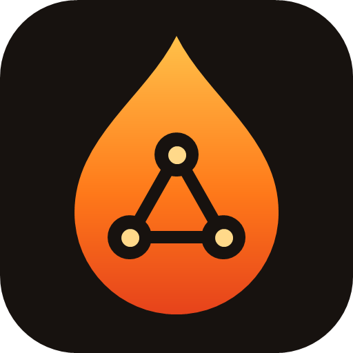
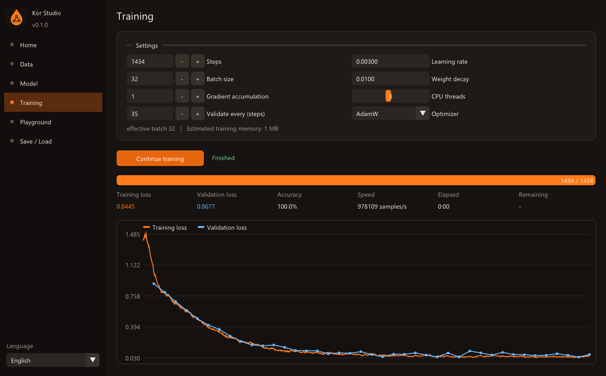

<p align="center"></p>
<h1 align="center">Kor Studio</h1>
<p align="center"><b>Обучайте собственную ИИ-модель на том железе, что у вас есть.</b><br>
<a href="../README.md">English</a> · <a href="README.tr.md">Türkçe</a> · Русский</p>

Kor Studio — бесплатная настольная мастерская с открытым исходным кодом для **проектирования,
обучения и проверки собственных нейросетей**. Движок обучения написан с нуля на C++17 без
сторонних ML-библиотек и сам подстраивается под ваш компьютер, поэтому небольшие модели
обучаются на обычном процессоре.

*Kor* по-турецки значит «уголёк»: маленький огонёк, которого хватает, чтобы разжечь пламя.



## Возможности

- **Данные** – текстовый файл (обучает посимвольную языковую модель) или таблица CSV
  (обучает классификатор или регрессор). Тип задачи определяется автоматически.
- **Модель** – проектируйте сеть визуально или нажмите *Автонастройка под мою систему*:
  Kor подберёт размер под вашу память, процессор и данные.
- **Обучение** – графики ошибки в реальном времени, проверка, точность, скорость,
  оставшееся время, пауза/продолжение/остановка, ранняя остановка и журнал обучения,
  который также сохраняется в файл.
- **Проверка вопросами** – обучить, затем спросить: строки `вопрос => ожидаемый ответ`
  (для диалогов заполняются автоматически). Модель проверяется во время обучения, сохраняются
  веса, ответившие на большинство вопросов, а обучение может остановиться, когда все ответы верны.
- **Плагины** – скрипты на Python, которые готовят или создают данные, пишут тесты и проверяют
  модели ([docs/plugins.md](plugins.md)). Три плагина входят в комплект.
- **Проверка** – генерируйте текст или получайте предсказания прямо во время обучения.
- **Сохранение / загрузка** – модели хранятся в открытом [формате `.kor`](kor-format.md).
- **Три языка** – русский, английский и турецкий, переключаются на лету.

## Почему это легко

| Приём | Что он даёт |
|---|---|
| Автонастройка | Размер модели, батч и число потоков подбираются по свободной памяти, числу ядер и объёму данных |
| Накопление градиентов | Большой эффективный батч, когда в памяти лишь один маленький |
| Дообучение LoRA | Адаптация обученной модели обучением малой доли весов |
| Файлы половинной точности | Сохранённые модели занимают вдвое меньше места |
| Выбор SIMD при запуске | AVX2/FMA, если процессор их поддерживает, иначе переносимые ядра |

### Честно о возможностях

Kor Studio v0.2 обучает на **процессоре**. Он рассчитан на небольшие модели: табличные сети и
посимвольные трансформеры до нескольких миллионов параметров, которые обучаются на ноутбуке
за секунды или минуты. Модель размера ChatGPT на ноутбуке обучить нельзя — этого не может
ни одна программа. Поддержка видеокарт запланирована.

## Сборка

Требуется: CMake 3.20+, компилятор C++17 (GCC, Clang или MSVC), Git и OpenGL 3.0.
GLFW и Dear ImGui загружаются CMake автоматически.

```bash
cmake -S . -B build -G Ninja
cmake --build build
./build/bin/kor-studio
```

## Лицензия

[MIT](../LICENSE).
