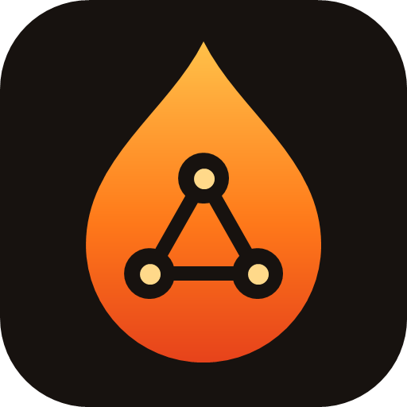
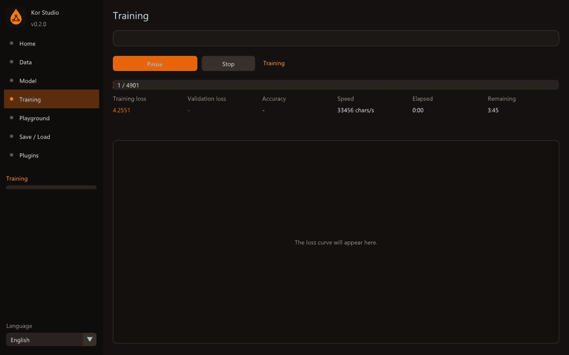

<p align="center"></p>
<h1 align="center">Kor Studio</h1>
<p align="center"><b>Kendi yapay zekâ modelini elindeki donanımla eğit.</b><br>
<a href="../README.md">English</a> · Türkçe · <a href="README.ru.md">Русский</a></p>

Kor Studio, **kendi sinir ağlarını tasarlaman, eğitmen ve denemen** için ücretsiz ve açık kaynaklı
bir masaüstü atölyesidir. Eğitim motoru, altında hiçbir yapay zekâ kütüphanesi olmadan sıfırdan
C++17 ile yazıldı ve kendini bilgisayarına göre ayarlar; böylece küçük modeller sıradan bir
işlemcide eğitilir.

*Kor*, ateşin közüdür: bir ateşi başlatmaya yeten küçük bir parıltı.



## Neler yapar

- **Veri** – düz metin dosyası (karakter düzeyinde dil modeli eğitir) veya CSV tablosu
  (sınıflandırıcı ya da regresyon modeli eğitir) yükle. Görev otomatik algılanır.
- **Model** – ağı görsel olarak tasarla ya da *Sistemime göre otomatik ayarla* düğmesine bas;
  Kor belleğine, işlemcine ve verine uygun boyutu seçsin.
- **Eğitim** – canlı kayıp eğrileri, doğrulama, doğruluk, hız, kalan süre, duraklat/sürdür/durdur,
  erken durdurma ve dosyaya da kaydedilen bir eğitim logu.
- **Soru testleri** – önce eğit, sonra sor: `soru => beklenen cevap` satırları yaz (diyalog
  verisinde otomatik doldurulur). Test soruları eğitim verisinden çıkarılır, yani model hep
  hiç görmediği sorularla sınanır: ezberi değil gerçekten öğrenip öğrenmediğini ölçer. Model
  eğitim sırasında sınanır, en çok soruyu bilen ağırlıklar korunur ve istenirse bütün cevaplar
  doğru olunca eğitim kendiliğinden durur.
- **Eklentiler** – veri hazırlayan veya üreten, test yazan ve modeli sınayan Python betikleri
  ([docs/plugins.md](plugins.md)). Üç eklenti hazır gelir.
- **Deneme** – eğitim sürerken bile metin üret veya tahmin yap.
- **Kaydet / Yükle** – modeller açık [`.kor` biçiminde](kor-format.md) saklanır.
- **Üç dil** – Türkçe, İngilizce ve Rusça; çalışırken değiştirilebilir.

## Neden hafif

| Teknik | Kazancı |
|---|---|
| Otomatik ayar | Model boyutu, batch ve iş parçacığı sayısı boş belleğe, çekirdek sayısına ve veri boyutuna göre seçilir |
| Gradyan biriktirme | Bellekte tek küçük batch varken büyük etkili batch |
| LoRA ince ayar | Ağırlıkların çok küçük bir kısmını eğiterek eğitilmiş modeli uyarlama |
| Yarı hassasiyetli kayıt | Kayıtlı modeller diskte yarı yer kaplar |
| Çalışma anında SIMD seçimi | İşlemci destekliyorsa AVX2/FMA, desteklemiyorsa taşınabilir çekirdekler |

### Dürüstçe: ne beklemeli

Kor Studio v0.2 eğitimi **işlemcide** yapar. Küçük modeller içindir: tablo ağları ve birkaç milyon
parametreye kadar karakter düzeyinde transformer'lar; bunlar bir dizüstünde saniyeler ya da
dakikalar içinde eğitilir. ChatGPT boyutunda bir modeli dizüstünde eğitmez; bunu hiçbir program
yapamaz. Ekran kartı desteği yol haritasındadır.

## Derleme

Gerekenler: CMake 3.20+, C++17 derleyicisi (GCC, Clang veya MSVC), Git ve OpenGL 3.0.
GLFW ve Dear ImGui, CMake tarafından otomatik indirilir.

```bash
cmake -S . -B build -G Ninja
cmake --build build
./build/bin/kor-studio
```

### Komut satırı

```bash
kor-cli train examples/diyalog_tr.txt --target 1 --log egitim.log --out sohbet.kor
                                         # diyalog: bütün soru testleri geçince dur
kor-cli test sohbet.kor testler.txt --data examples/diyalog_tr.txt
kor-cli generate sohbet.kor "Kullanıcı: Merhaba" --len 200
```

## Lisans

[MIT](../LICENSE).
