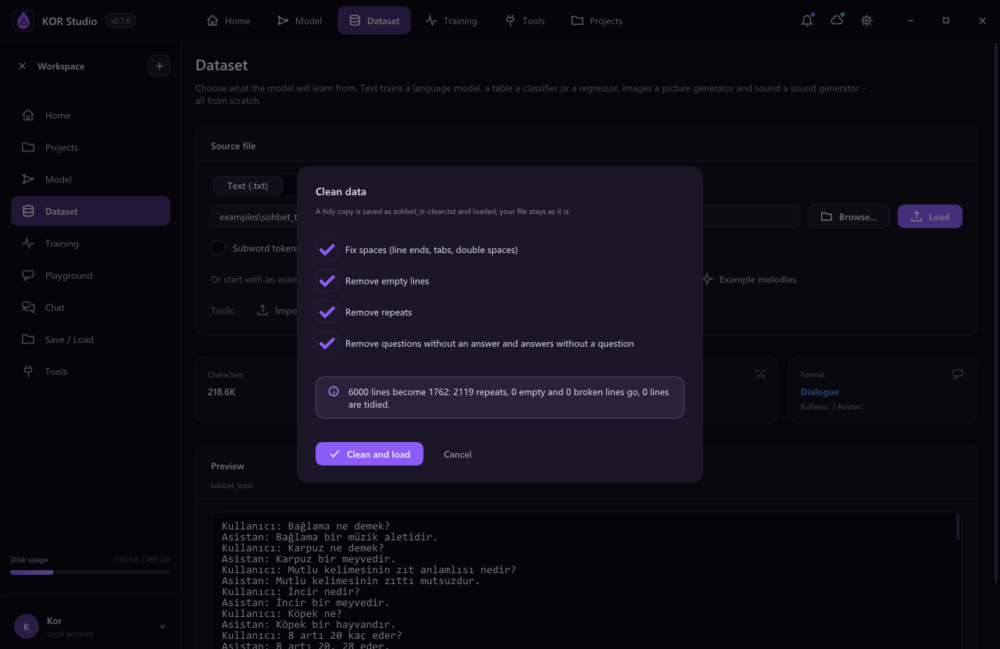

Kor Studio 0.7.0 adds a local OpenAI-compatible API, training comparison, dataset tools, experimental GPU support, an installer and automated builds.

## New

- **Local OpenAI-compatible API.** `kor-cli serve model.kor` answers on `http://127.0.0.1:8080/v1` with `/v1/models`, `/v1/chat/completions` and `/v1/completions`, including streaming. The chat page has a *Serve as API* button. Only this computer can reach it unless `--host` says otherwise; `--api-key` and `--cors` are available.
- **Compare trainings.** Every finished or stopped run is recorded. The new *Compare* tab on the training page draws the loss curves of several runs on one chart, next to a table of their data, model, steps, time, best loss, accuracy and test results.
- **Dataset tools.** Import chat datasets in JSON Lines (OpenAI `messages`, ShareGPT, Alpaca, `prompt`/`completion`, `question`/`answer`) as dialogue text; loading a `.jsonl` file in the app imports it. *Clean data* tidies spaces and removes empty lines, repeated question-answer pairs and questions without an answer, and shows what will change before it writes a cleaned copy. On the command line: `kor-cli data import` and `kor-cli data clean`.
- **Graphics card (experimental).** Text models can run their large matrix products on an OpenCL GPU (*Graphics card* in the training settings, `--gpu` on the command line). The GPU results are checked against the CPU and both are timed at the start; if the card is missing, wrong or slower, training stays on the CPU. `kor-cli gpu` prints the comparison. On an RTX 3050 Ti Laptop GPU, training-sized products ran 5 to 9 times faster than on the CPU, copies included.
- **Update notice.** The app checks GitHub for a newer release and shows it in the notifications and the settings (can be turned off).
- **Installer.** `kor-studio-0.7.0-setup.exe` installs for the current user without administrator rights, adds a Start menu entry and can put `kor-cli` on the PATH.
- **Automated builds.** GitHub Actions builds and tests every change on Windows and Linux and publishes tagged releases, including a Linux `.tar.gz`.

## Download

- `kor-studio-0.7.0-setup.exe`: the installer.
- `kor-studio-0.7.0-windows-x64.zip`: the portable version; extract it and run `kor-studio.exe`.

Windows 10 or newer with a 64-bit CPU is required. Python 3 is only needed for plugins and skills. The programs are not code-signed yet, so Windows SmartScreen may ask for confirmation (*More info* → *Run anyway*).

## License

Kor Studio is licensed under the **PolyForm Noncommercial License 1.0.0**: free for any noncommercial use, but it may not be sold or used commercially.

## Known limitations

- The GPU support covers only the large matrix products; attention and the optimizer stay on the CPU, so small models gain little or nothing.
- The releases are not code-signed. On PCs with Smart App Control turned on, Windows may refuse to run them.
